# Monitor Buddy: a tiny screen that keeps an eye on my workday

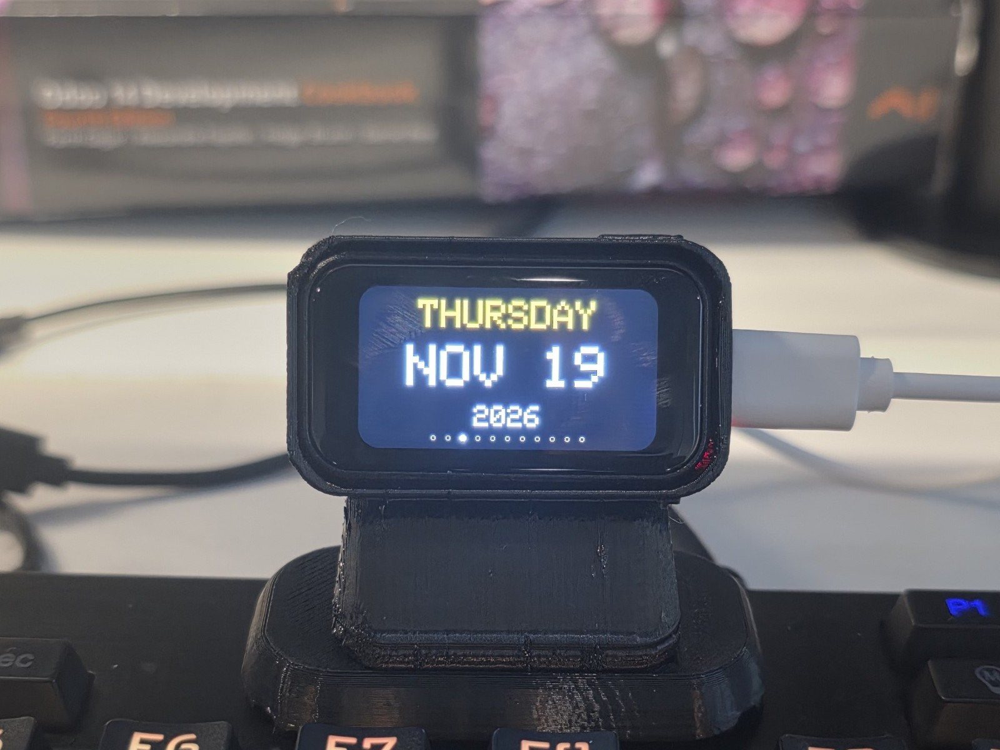

A 1.47-inch screen sits on my keyboard, and it has opinions. When I lock the laptop at lunch, it starts chewing. When one of my pull requests goes red, its eyes turn red and shake. When Claude Code stops to ask me something, it looks up, surprised, and says so. Knock twice on its head and it asks "WHAT'S UP?".

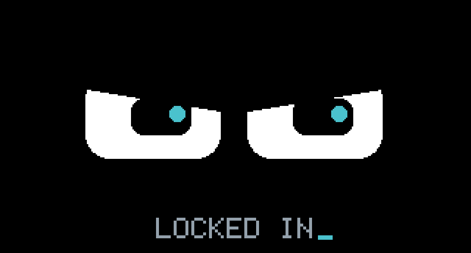

This is the story of how a cheap ESP32 touchscreen became a desk companion that follows my working day: Odoo, GitHub, Google Calendar and Claude Code, on a screen smaller than a matchbox.

## Where it started

[Monitor-Buddy by IdefixRC](https://github.com/IdefixRC/Monitor-Buddy) is a lovely open-source project under the MIT licence: a Waveshare ESP32-C6-Touch-LCD-1.47 board in a 3D-printed holder, with an animated face that follows the motion sensor, a clock, weather, moon phase, stocks, coins, a GitHub page, a browser-based flasher and a captive-portal Wi-Fi setup. I flashed it, put it next to my monitor, and it made me smile. Then I started wondering what it would take to make it care about my actual day.

If you only want to build one, skip to [Build one](#build-one) at the end.

Three days later the firmware had grown to about 6,000 lines, and the laptop had a helper service, a Chrome extension and a handful of small Python tools. Most of that came out of pair-programming sessions with Claude Code, which is also why the Buddy keeps an eye on Claude.

## What it follows

The Buddy only fetches the public bits itself: weather from Open-Meteo, my GitHub streak and stars, and the time. Everything about my work comes from the laptop, where a small Python service called `buddy-link` wakes up every five seconds and reads:

- **the screen lock**, from logind. GNOME's own `ScreenSaver.GetActive` stays false when you lock with Super+Escape, which is why my first lock detection passed every test and failed every real lock.
- **the microphone**, from PipeWire. If something records on two polls in a row, I'm ON AIR.
- **pull requests, reviews and CI**, through the `gh` CLI.
- **Claude Code**: hooks write "needs" or "done" and the project name to a small file, and my status line leaves the 5-hour and 7-day usage in another.
- **Google Calendar**, read-only from the cache GNOME keeps for its online accounts. No Google credentials involved.
- **Odoo**, through the browser.

It sends all of that to the Buddy over Wi-Fi, and over the USB cable when the Buddy is plugged in and the Wi-Fi isn't answering.

### The API key that died every day

My first Odoo integration was the obvious one: an API key compiled into the firmware, and the Buddy calling odoo.com itself. The key stopped working the next afternoon. My odoo.com keys expire after a day, so every renewal meant a new build, a new flash, and a fresh secret on a board that anyone with a USB cable can read.

So the Buddy stopped holding a key at all. A tiny Chrome extension (Manifest V3, allowed to talk to www.odoo.com and nothing else) wakes up every minute and asks Odoo for my numbers with the session the browser already has: today's hours, the previous working day's hours, open tasks, what's in development or code review, activities due, and the next meetings. It hands the JSON to a native messaging host, a 30-line Python script that writes it to a private file, and `buddy-link` forwards it. If Chrome is closed or I'm signed out, the data ages out after 30 minutes and the Odoo page drops out of the rotation. It only ever reads; nothing writes back to Odoo.

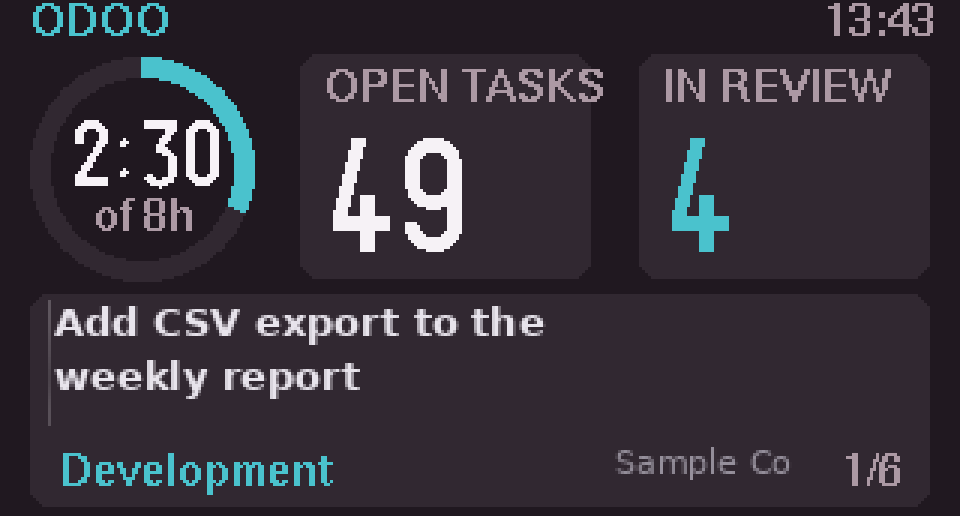

## Faces with personality

The face is still the heart of it: nine moods you can tap through, plus the status faces the Buddy picks by itself. On every frame it walks down a ladder and shows the first status that applies:

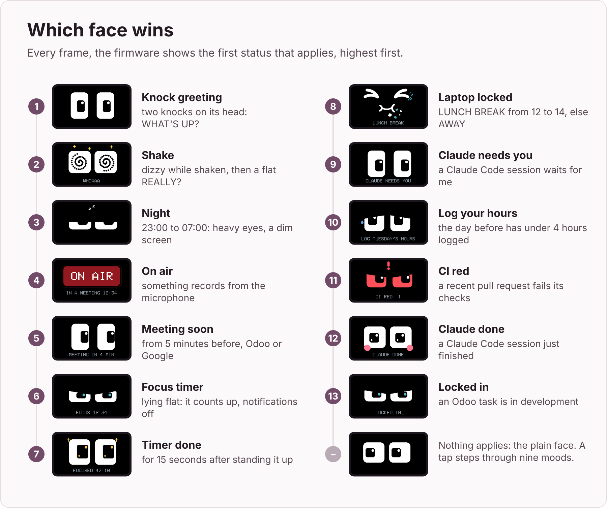

A few favourites:

- **LOG TUESDAY'S HOURS.** If the previous working day has under four hours on my timesheet, the eyes droop and a blue tear runs down. It names the day, so there's no arguing.
- **CI RED.** Red eyes shaking from side to side, with a "!" flashing between them.
- **LOCKED IN.** While one of my tasks is in development, the pupils sweep left to right like they're reading code, and a cursor blinks after the caption.
- **LUNCH BREAK.** I rejected three lunch faces drawn from lines and circles. What worked was a picture generated with Gemini, cropped and warped by a script into two 320×172 frames that swap every 260 ms. It chews.

 

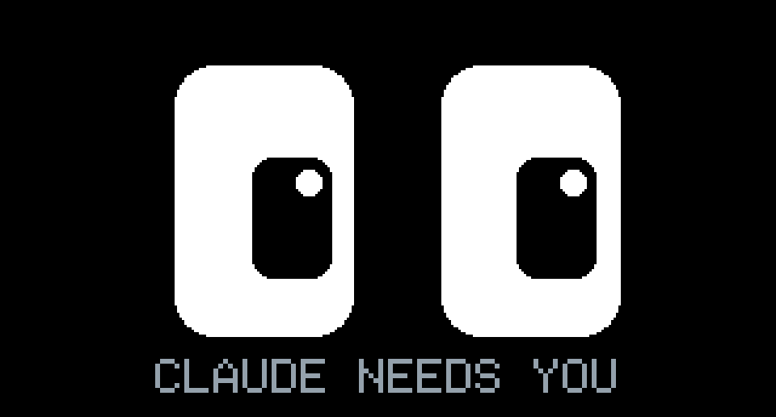 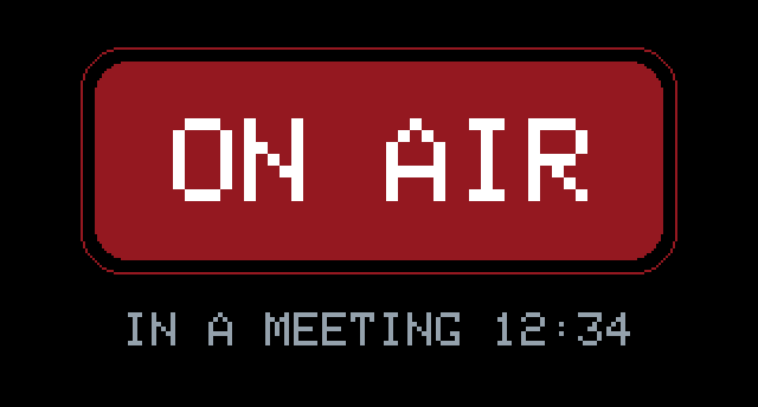

Put together, a day looks like this:

The first unlock of the day brings a YESTERDAY card (hours, tasks I touched, pull requests merged and reviewed), then the Today page. Meetings from Odoo and Google Calendar get a five-minute countdown. Laying the Buddy flat starts a focus timer that counts up; while it runs, the laptop turns notification banners off and keeps the screen awake with the Caffeine extension, which lets go after 30 idle minutes so an unattended laptop still locks. Locking up after 17:00 shows a DAY DONE recap.

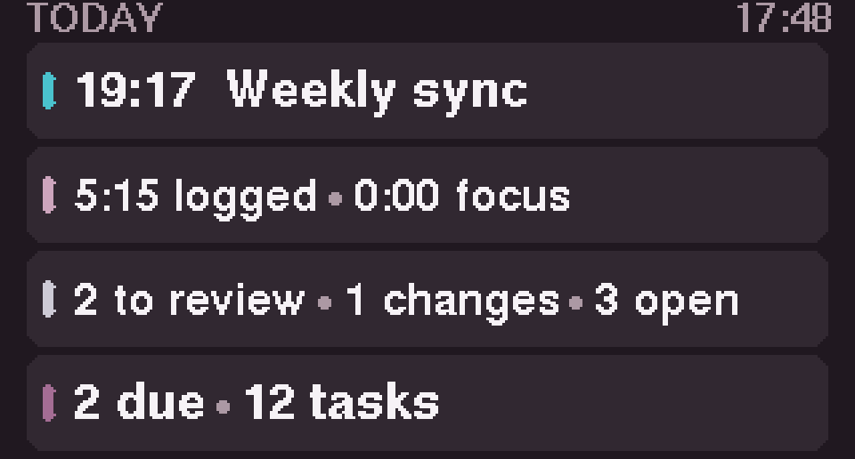

## Knock knock

The Buddy also reacts to being handled. Shake it and it goes dizzy, spiral eyes and circling stars, then gives you a flat "REALLY?" before showing the Today page. Spin it and it looks surprised. Knock twice on its head and it greets you.

 

The knock was the hardest feature to get right, and the one that taught me the most. My first detector looked at the change in the total pull, the length of the acceleration vector. A knock from the side barely changes that length, so desk knocks read 0.08 to 0.19 g, right on top of ordinary desk bumps. I then spent far too long nudging thresholds by feel: too strict and it missed knocks, too loose and typing set it off.

What fixed it was measuring. The Buddy's health answer now carries its last eight knock strengths, and its serial status line prints the largest jolt every 1.2 seconds. With real numbers in front of me, the cause was obvious, and so was the fix: measure the change in every direction, against a slow running average. Knocks on the Buddy itself now read 0.27 to 3.2 g, comfortably above anything the desk does.

A dedicated FreeRTOS task reads the QMI8658 motion sensor every 3 ms. A knock is a jolt of at least 0.25 g after the Buddy was still, and the first one needs 150 ms of stillness before it, which typing never provides. The second must come 80 to 700 ms later. Anything under a quarter of the first knock is the Buddy rocking on its stand, and a third strong jolt cancels the pair. Screen taps arrive with a touch, and picking the Buddy up never lets it get still.

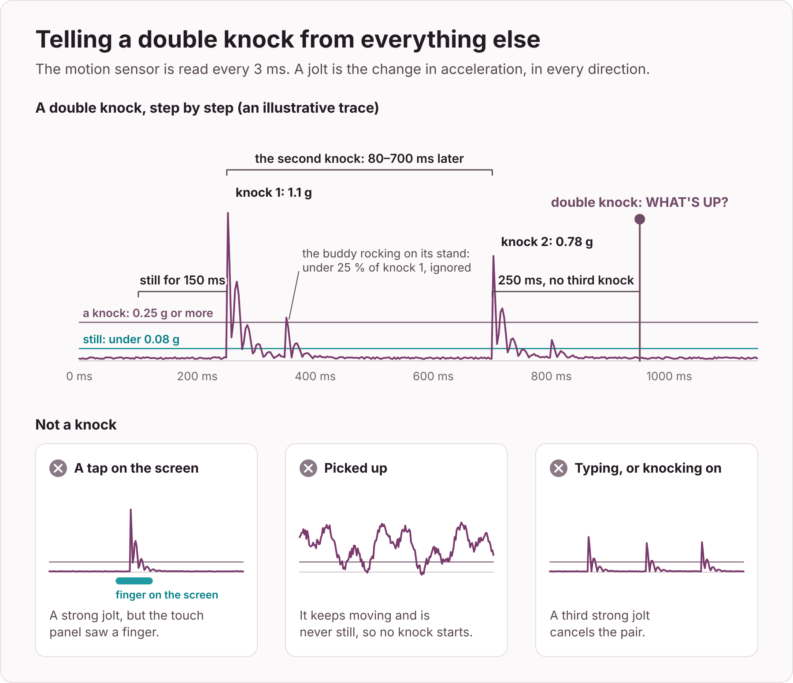

In the last test it caught two double knocks out of three, ignored a single knock, and fired on nothing else.

## Memes on a 1.47-inch screen

One page plays animations from the microSD card, and three of them play by themselves as reactions: a ring that fills up and bursts into confetti when my Odoo hours pass eight for the day, a green tick that draws itself when the last failing pull request goes green, and fireworks after a focus session of 25 minutes or more. After 30 minutes away, your name (you give it in the installer) bounces around the screen like the logo of an idle DVD player, and yes, it lands exactly in a corner twice per loop.

My own card also holds a few classics of the old internet, and those belong to their creators, so they stay on my card. Everything that ships with the project I drew with a script: the three reactions, the bouncing Buddy logo, a starfield, code rain, demo-scene fire, a game of Pong where nobody ever misses, and an install bar that crawls to 99% and fails.

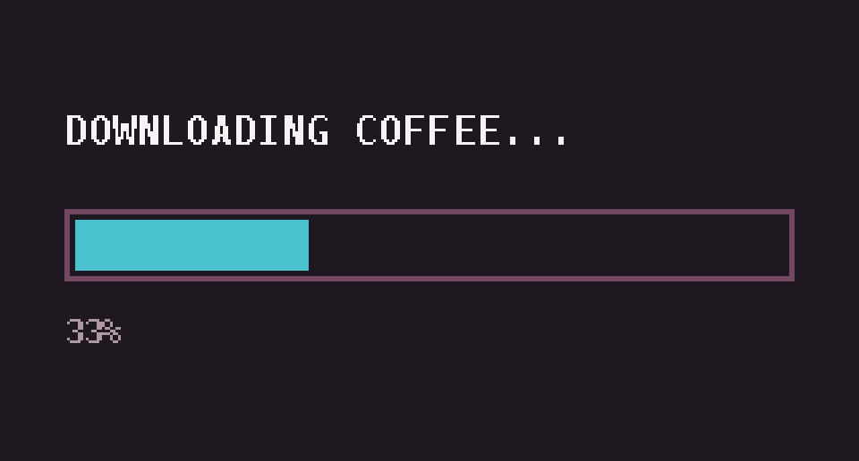

A helper script fits any GIF to the screen (three canvas sizes drawn at 4×, 2× or 1×, one shared 64-colour palette), and another sends it to the Buddy over the same link everything else uses.

## Locking it down

The Buddy sits on an office desk, shows my tasks and talks over Wi-Fi, so it got the same attention as the faces.

- **A sealed link.** Every UDP packet is encrypted and authenticated with AES-256-GCM. The nonce starts with the laptop's clock in milliseconds, and the Buddy only accepts stamps that keep increasing and sit within a minute of its own clock, so a recorded packet is useless a minute later. The Buddy never opens a connection; it only answers.
- **Signed updates.** Firmware sent over Wi-Fi carries an ECDSA P-256 signature, and the private key never leaves the laptop. The Buddy only has the public half, so someone who somehow got the link key still couldn't install firmware.
- **Rollback.** There are two firmware slots. A new firmware boots on trial and is kept only once it hears from the laptop again; if it crashes before that, the bootloader goes back to the old one. That found a real bug: a start-up crash when a network fetch looked up a host name while the time sync had its own DNS query open. The Buddy rolled itself back, the crash dump kept on flash pointed at the cause, and the time sync now gets IP addresses instead of names.
- **A privacy lock.** While the laptop is locked, swipes, taps, the game, the Wi-Fi setup hotspot and the Today pages after a knock or a shake are all blocked. Anyone walking past sees a face, not my task list.
- **No borrowed secrets.** Odoo comes through the browser, I deleted the stock-price API key, and I erased the spare firmware slot that still held old images with the expired Odoo key. What remains on the board is the link key and the Wi-Fi passwords.
- **The honest part.** USB is still the master key. There's no flash encryption and no secure boot, so anyone with a cable can read the board or flash it. It lives on my desk, not in a hallway.

Signed updates worked perfectly on my desk and fell apart in a weak spot on a charger. There, 8 of 40 sealed pings got lost, the median round trip was 187 ms, and three installs broke off between 67 and 135 KB of a 1.9 MB image.

So updates became resumable. The Buddy keeps a broken-off update for ten minutes, and because the signature is deterministic (RFC 6979), running the same command again sends exactly the same header. The Buddy recognises it and answers with the offset where it stopped. I tested it by cutting the Wi-Fi at 63%: the second run went on from 65% and finished. Over USB an install takes 23 to 25 seconds; over Wi-Fi, in 1 KB pieces, about 90.

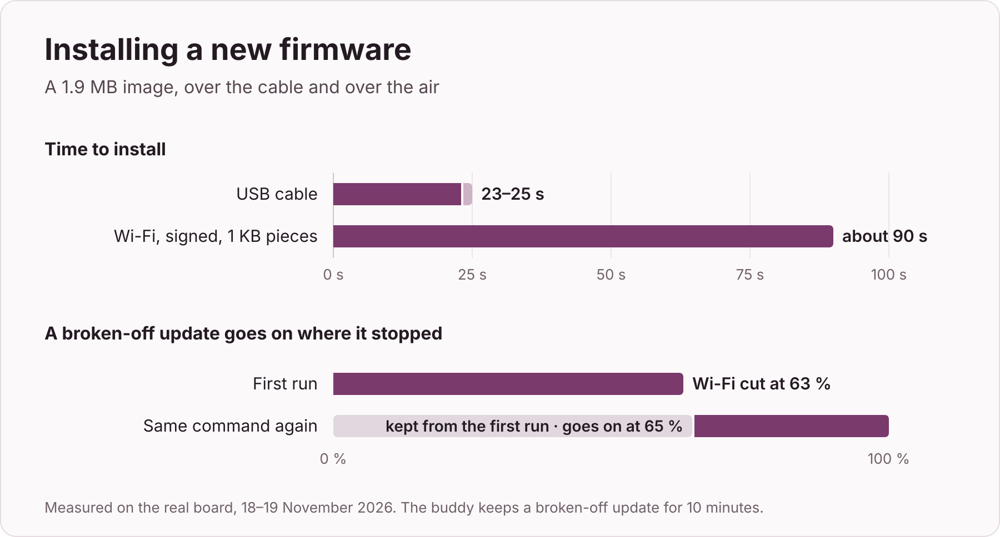

## From 12 to 30 frames a second

The firmware I started from sent the whole 320×172 frame to the display on every pass, which takes about 30 ms on its own. Add Wi-Fi upkeep, the motion sensor, touch and a fixed delay, and the face ran at 11 to 12 frames a second.

Doing Wi-Fi upkeep every 500 ms instead of every pass bought a little. The big win was hashing every row of the frame buffer and sending only the rows that changed, with frames paced at 33 ms: the normal pages went to 30. The eyes still move on springs that step every 70 ms, with the frames in between blended, so the face kept the feel it had at 12. The Bug Hop game, a one-tap runner hidden one swipe past the animations, has its own partial flush and no pacing, so it runs at 29 to 40. Adding the knock watch cost a few frames while the sensor bus ran at 100 kHz, and moving it to 400 kHz brought them back. GIFs from the SD card land at 21 to 23, probably because the card shares its SPI bus with the display.

## A dock for the keyboard

The original holder sticks to the side of a monitor. Mine wanted to live on the keyboard, where a knock is one finger away and laying it flat for a focus timer is a single move. So the holder became the head of a two-part dock: a 7 mm slab that sits on the keyboard's top strip, and a head that leans the screen back toward me. The head drops into a dovetail groove, slides 8 mm and clicks; slide it back and it lifts off with its cable.

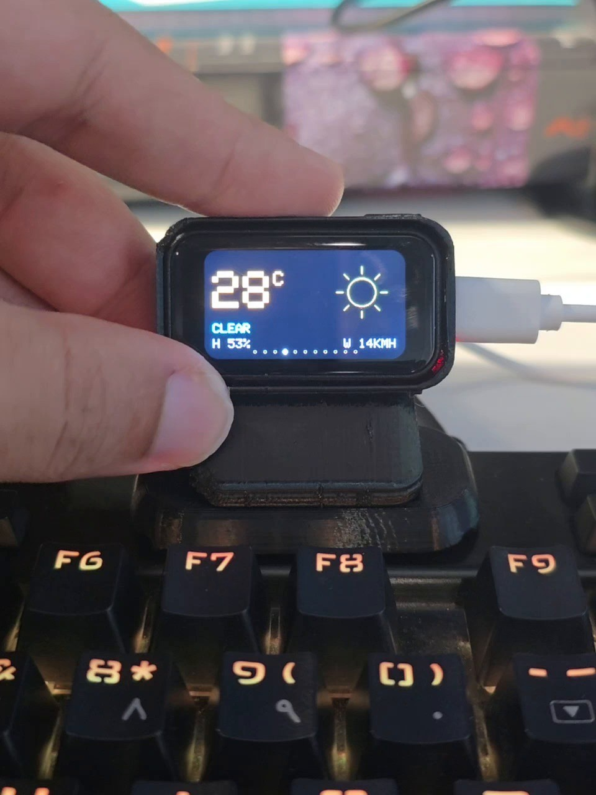 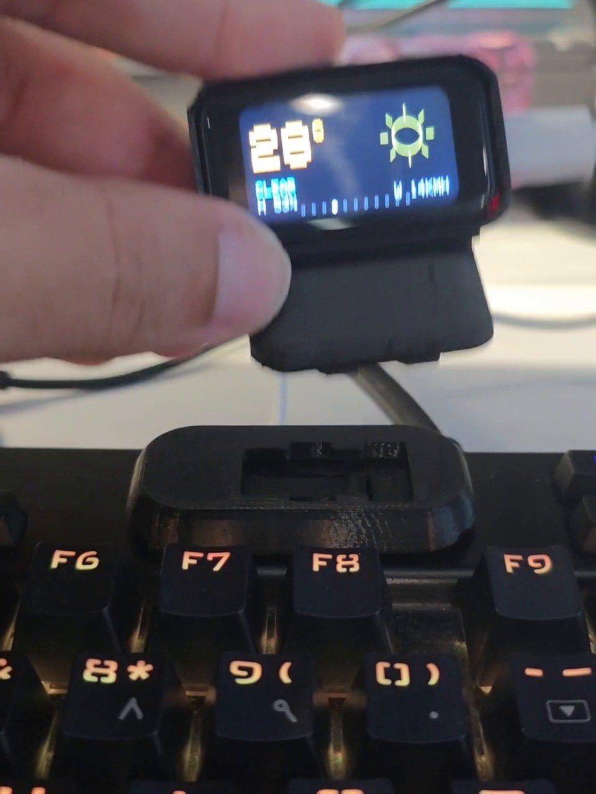

It took eight versions. Version 7 looked finished and reset the board every time I seated it: a ledge inside the holder stood exactly where the BOOT and RST buttons stick out of the board's edge. Version 8 clears both buttons by 1.5 mm and leaves two small pin slots to reach them.

## Small bugs, big lessons

**`millis() | 1`.** Time stamps were stored as `millis() | 1`, so that zero could mean "unset". That can put a stamp one millisecond in the future, and then `millis() - stamp` underflows to about four billion. "Lie flat for two seconds" fired instantly: a surprise focus timer that also muted my notifications. Every such comparison now goes through a helper that handles it.

**A button with a mind of its own.** The BOOT button read as pressed during a restart, and the upstream rule "hold BOOT for five seconds to forget the Wi-Fi" wiped the saved Wi-Fi three times in one day. BOOT lost that job. Today a press locks the laptop, which travels over the same sealed link as everything else.

Add the knock and the API key, and two rules stick: measure before you tune, and don't store a secret you can borrow from somewhere safer.

## What's next

A battery: the board has a charger chip, and a small LiPo with a protection board would let the Buddy leave the cable behind. And the Buddy could use a few more faces, which, if the lunch face taught me anything, will start as generated pictures rather than circles.

## Build one

This is a free, open-source hobby project; nothing is for sale. You need a Waveshare ESP32-C6-Touch-LCD-1.47 (the touch version), a USB-C data cable, a small microSD card if you want the animations, and about 23 g of PLA.

1. **Print** the dock (two parts, about 1 h 24 min at 0.16 mm) or the original holder. The original holder, with its print settings, is on MakerWorld; my dock goes up there as a remix of [the original model](https://makerworld.com/en/models/3241960-monitor-buddy).
2. **Install from the browser.** Plug the board in, open the [installer](https://abdaishere.github.io/monitor-buddy/) in Chrome or Edge, click **Connect your Buddy**, then **Install**. One form asks for your Wi-Fi and your city; nothing has to be built or installed on the computer.
3. **Copy the animations** from the release's `monitor-buddy-v1.0.0-sdcard.zip` onto the card and put it in while the Buddy is unplugged (the card is read at start-up).
4. **Connect your laptop** (Linux, optional): install `monitor-buddy_1.0.0_all.deb` from the [latest release](https://github.com/Abdaishere/monitor-buddy/releases/latest) (Ubuntu and Debian), or download the project from [github.com/Abdaishere/monitor-buddy](https://github.com/Abdaishere/monitor-buddy) and run `open-app.sh` (or `./setup.sh` in a terminal). With the Buddy on USB, click **Set up**. It makes the keys, hands them to the Buddy over the cable, starts the helper for the lock, microphone, pull request, calendar and Claude Code features, and offers the Odoo extension. It can be run again at any time and only does what is left.

5. **Make it yours.** The same app is the Buddy's editor: it shows the Buddy's screen live next to its settings (the real firmware, built to run in the page), lets you drag the pages into your own order, and writes the changes over the cable, with undo. The editor also runs on Windows.

Updates come from the same installer page, or over Wi-Fi with `python3 tools/buddy_flash.py`. The [README](https://github.com/Abdaishere/monitor-buddy#set-up) has the steps with screenshots, and the [handover document](https://github.com/Abdaishere/monitor-buddy/blob/main/docs/HANDOVER.md) has every detail.

## Credits

Monitor Buddy stands on [Monitor-Buddy by IdefixRC](https://github.com/IdefixRC/Monitor-Buddy) (MIT), which builds on the Tiny ESP DeskBuddy idea from [schematik.io](https://schematik.io/) and took additional face designs from [DESKBUDDY-1.0 by Edison Science Corner](https://github.com/EDISON-SCIENCE-CORNER/DESKBUDDY-1.0). Thanks to IdefixRC and to the original's contributors, AmyJoT and Killo1988. The browser installer uses esptool-js by Espressif and posix_tz_db by Nayar Systems. The firmware uses Arduino_GFX, ArduinoJson, U8g2, AnimatedGIF and AyresWiFiManager, and the weather comes from [Open-Meteo](https://open-meteo.com/). The dock's head is built on IdefixRC's [printed holder](https://makerworld.com/en/models/3241960-monitor-buddy), so the dock is published on MakerWorld only, as a remix of it. The full list is in [CREDITS.md](CREDITS.md).
